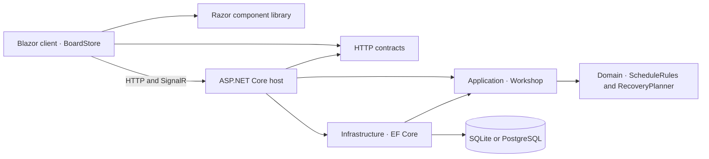
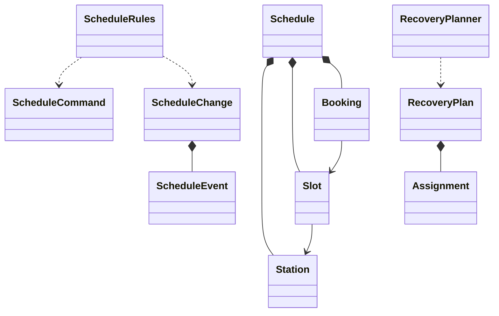
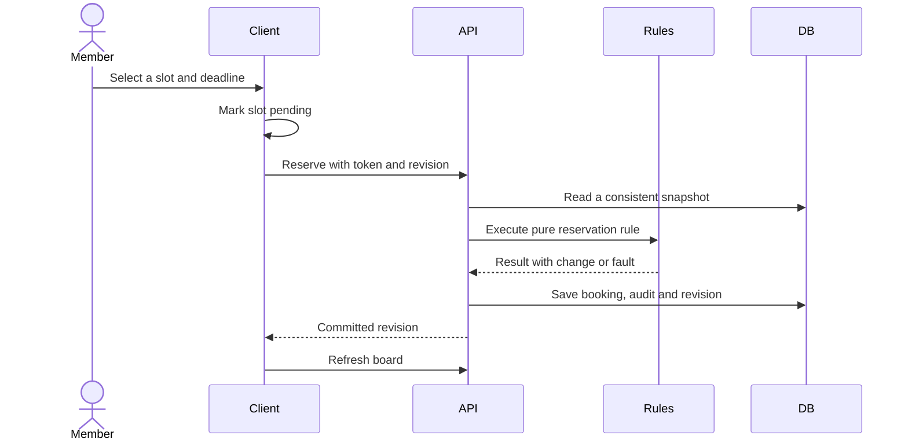
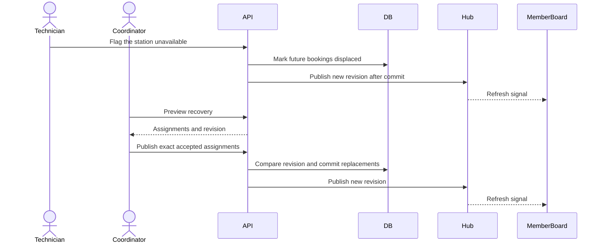
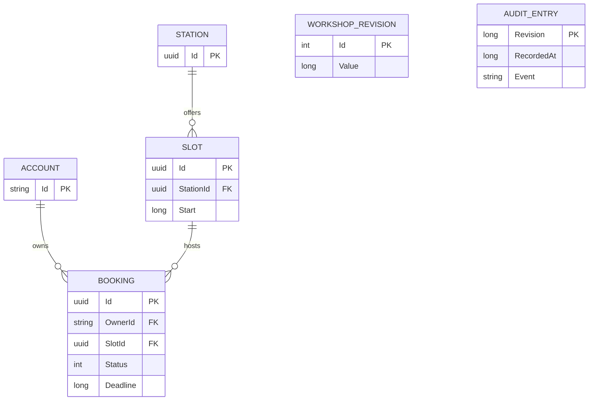
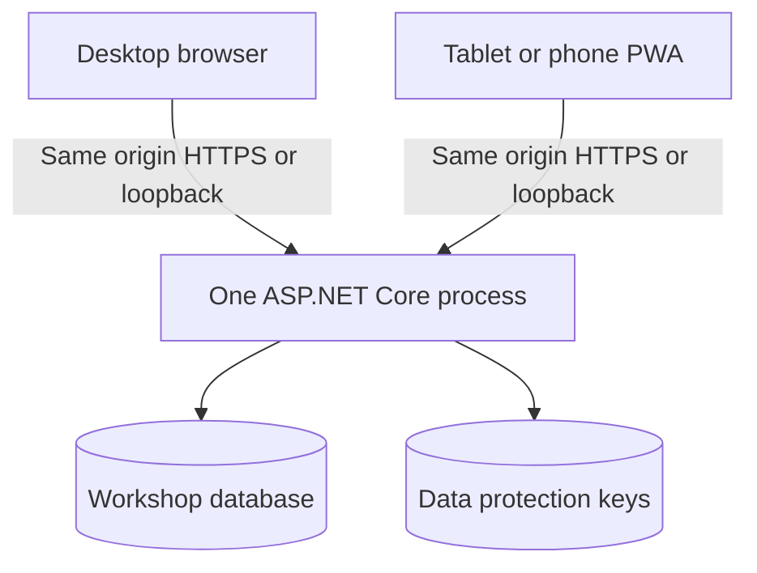

# Benchline architecture

## Components and dependencies

The client follows Flux-style unidirectional state. `BoardStore.Dispatch` sends an action to `BoardStore.Reduce` and notifies subscribers only when state changes. `BoardState.AvailableFor` and `AvailableCount` are selectors. A pending reservation hides its slot from the optimistic availability count. A rejection releases it and may refresh the board. The snapshot stays in memory. Theme preference is the only application data stored in local storage.

`Home` coordinates network and dialog effects. `WorkshopHeader`, `BookingsList`, `BookingDialog`, `RecoveryQueue`, `RecoveryDialog` and `AuditLog` render feature views and emit typed callbacks. The shared library holds `ScheduleGrid`, `ScheduleCell`, `StatusChip`, `StationFilter`, `ConnectionStatus` and `WorkshopNotices`, with examples on `/components`. The grid groups hours by the Astana calendar date and leaves gaps empty. An open cell emits its slot, while the station action emits its station. Both callbacks open the same dialog. The browser API returns a typed reply with a value or a structured HTTP failure.

Storage, HTTP timestamps and domain rules use UTC instants. The UI and CSV export share `AstanaTime` for display. Both timestamp columns in the CSV represent the same instant.

## Domain class model

`Schedule.cs` defines immutable records and immutable collections. A slot covers exactly one hour and a station cannot have two slots with the same start. Command, event and result families use sealed record variants and switch expressions for dispatch. `Result<T>.Map` transforms only a success, independently of the function supplied by the caller. Expected validation and permission failures carry a structured `Fault`.

`ScheduleRules.Execute` and `RecoveryPlanner.Build` are pure. The clock is an explicit input. LINQ expresses capabilities, eligibility and occupancy. The planner uses local dictionaries when searching for augmenting paths. Those mutations are private to the call and the resulting plan is independent of prior calls. `Workshop` is the imperative shell. It supplies time, asks the repository for a snapshot, invokes the rule and commits the resulting event.

## Matching policy

The left side of the graph contains disrupted reservations with time left before the deadline. The right side contains future open slots at working stations with the same capability. An edge exists when the replacement starts no earlier than the original and ends by the member's deadline. The planner processes bookings by original start, then deadline and ID. It examines slots by start and ID. When a slot is held by another candidate, an augmenting path may move that candidate to a different compatible slot. Each search visits a slot at most once. A maximum-cardinality matching recovers as many reservations as possible under the rules. It does not optimize total delay or equity across repeated outages.

## Reservation sequence

## Recovery sequence

## Storage model

`EfScheduleRepository.Read` uses a consistent database read transaction with fixed no-tracking queries. `TryWrite` compares the revision as an EF Core concurrency token. A single transaction writes the changed entities, revision and audit row. A filtered unique index limits a slot to one active booking while retaining displaced or cancelled history.

A coordinator confirms assignments against the preview revision. The API reconstructs the plan with the current time and compares the exact moves. A stale revision or changed plan returns a conflict without modifying reservations. SignalR notifications carry only a revision and are sent after commit. The client also refreshes after reconnection and periodically while connected.

After migrations in Demo, `DemoData` updates existing demo display names and campus spaces in place. `DemoSchedule` uses the injected time and the domain recovery planner to check whether the practice scenario can still run. When it cannot, `DemoData` replaces sessions and bookings for the four demo stations and records a new revision in the same transaction. Schema migration is the only startup database operation outside Demo.

## Deployment

The Docker release image uses a mounted data directory and a non-root process. The PWA caches versioned static assets and excludes API and hub paths. Data remains server-authoritative. The component showcase loads through the router on first visit. The service worker caches it separately after a successful request. The audit screen virtualizes the loaded rows inside a scroll region. [Developer notes](DEVELOPER_NOTES.md) describe the PostgreSQL switch and horizontal scaling dependencies.
