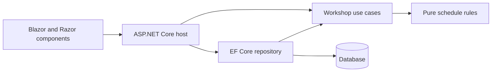

# Benchline project defense

Shakhriyar Yerzhanov and Aidyn Yeskendirov, IT-2504

## 1 Benchline

We built Benchline for equipment scheduling and outage recovery in a campus makerspace.

## 2 Workshop disruptions

We handle outages that disrupt several reservations at once. We show the impact to members and give staff a recovery plan that respects finish deadlines.

## 3 Aim and scope

We recover the largest feasible set of displaced reservations. We cover one workshop, fixed one-hour sessions and a timetable in Astana time (UTC+5). We support booking for members, availability controls for technicians, and recovery preview and publishing for coordinators.

## 4 Implementation phases

We defined and tested the scheduling rules, connected the database, API and board, and verified the published demo on three browser engines. The [development phases](../DEVELOPMENT_PHASES.md) record what we completed and checked.

## 5 Related products

| Product | Documented approach | What we used in Benchline |
| --- | --- | --- |
| Skedda | Booking conditions and availability windows | We validate at booking time. |
| Booked | Schedulable equipment and scoped approvals | We separate resources and roles. |
| Benchline | Preview and publish batch replacements | We recover within deadlines. |

[Skedda booking conditions](https://support.skedda.com/en/articles/112700-booking-conditions) and [Booked resources](https://www.bookedscheduler.com/help/administration/resources/).

## 6 Technology choices

We use Blazor WebAssembly and shared typed contracts for the installable client. We host the API and SignalR in ASP.NET Core and use EF Core with SQLite or PostgreSQL. We package the published host with Docker and use C# 12 on .NET 10 LTS.

## 7 Architecture

We compose booking, recovery and audit views from focused components. We handle their typed callbacks on the page and dispatch state changes to the store. We pass time into the pure rules and persist accepted changes through a repository interface.

## 8 Interface and methodology

We show the running demo in the light theme. We display sessions in Astana time (UTC+5) and show the campus space alongside each station. We use outlines, fills and distinct hatch patterns to identify session states. We prefill the booking time from the selected cell. In the [mockups](mockups/workflows.html), we show both themes, the dialogs and the stacked phone layout.

## 9 Functional design

We pass an immutable schedule and a sealed command into the rule function. We return a changed schedule with an event or a typed fault. We reduce each board action to a new client snapshot.

## 10 Recovery matching

We start with two backup slots. Member A can use either slot, and member B can use only the earlier slot. We move A to the later slot so B can use the earlier one. Both finish by their deadlines.

## 11 Concurrent edits

We capture the schedule revision in the preview. We recheck the revision and exact moves when publishing. We commit the bookings, audit and revision together, then broadcast the new revision through SignalR.

## 12 Live demonstration

We book in FabLab as Aidos Serikov and report the outage in Coworking Zone as Nurlan Tolegenov. We publish the moves to Open Space as Dana Kassymova. We verify the new location on both members' boards, including Aruzhan Nurgaliyeva's, and export the audit. We verified that startup updates demo names and places on the existing volume.

## 13 Testing and quality

We passed 50 .NET tests and 12 browser cases across a fresh stack and an old-volume restart. We verified role restrictions, competing reservations, typed faults, board callbacks, stale previews and CSV export. We measured unit-suite line coverage of 96.15% in Domain and 95.83% in Application. See [the QA report](../QA_REPORT.md).

## 14 Challenges and limitations

We use one workspace revision to serialize changes and a unique active-slot index to prevent double booking. We require a connection for writes. We recorded cold sign-in measurements and remaining checks in the [QA report](../QA_REPORT.md#lighthouse).

## 15 Result and limits

We recovered both seeded reservations within their deadlines. We verified the published workflow in browsers. We list physical device installation and manual screen-reader interaction as unverified.
